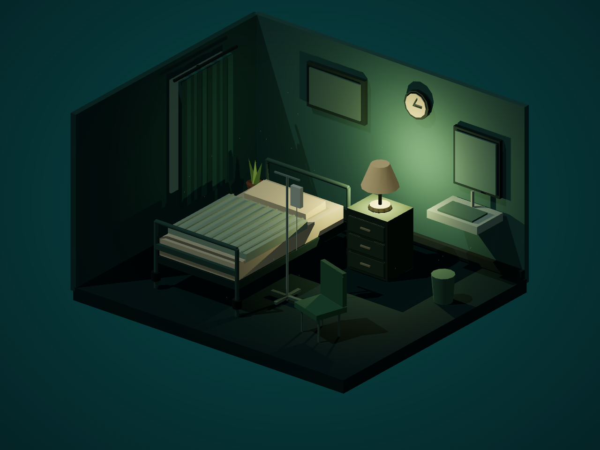
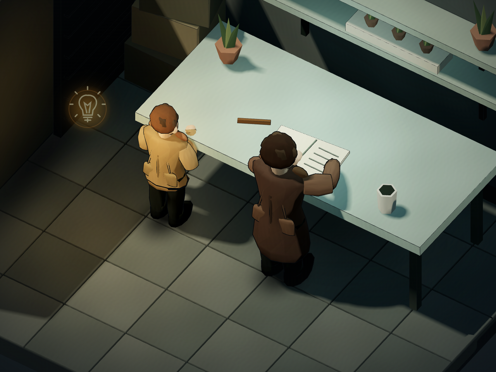

# Animaciones con Remotion y Three.js

Base en React y TypeScript para crear vídeos 3D. Incluye Orbit: 6 segundos, 1920 × 1080, 30 fps.

## Requisitos y uso

Node.js 22 o superior y npm.

```sh
npm ci
npm start
```

Abre Remotion Studio para previsualizar y editar.

```sh
npm run typecheck
npm run build
npm run render
```

El vídeo se guarda en `out/orbit.mp4`. El primer render puede descargar Chrome Headless Shell. Linux necesita las bibliotecas de Chromium y soporte de ANGLE para WebGL.

## Personalización

- `src/Orbit.tsx`: geometrías, materiales, luces y movimiento.
- `src/Root.tsx`: duración, resolución y fps.

Los movimientos usan `useCurrentFrame()` para reproducir cada fotograma de forma determinista. Evita animaciones basadas en el reloj o `useFrame()` al exportar.

Revisa los requisitos de licencia de Remotion antes del uso en producción: https://www.remotion.dev/docs/license


## Dioramas de las referencias

En Studio, abre la carpeta **Dioramas**:

- **Hospital**: habitación low-poly isométrica, cama, suero, cortinas en movimiento, lámpara cálida, lavabo, reloj, silla y polvo suspendido. Paleta verde y luz nocturna.
- **Workshop**: taller ilustrado con materiales toon, contornos en muebles, dos personajes de malla procedural con abrigos, bolsillos, cabello por mechones y brazos articulados, plantas, cuaderno y bombilla SVG pulsante.

Ambas composiciones duran 8 segundos a 30 fps, en 1280 × 960. Son interpretaciones construidas con geometría procedural, sin modelos externos; los personajes son estilizados y están modelados mediante secciones elípticas. No son reproducciones exactas de las imágenes.

```sh
npm run render:hospital
npm run render:workshop
```

Para exportar imágenes de muestra:

```sh
npm run still:hospital
npm run still:workshop
```

Los resultados quedan en `out/`. Edita `src/scenes/Hospital.tsx` y `src/scenes/Workshop.tsx`; el modelado de personajes está en `src/scenes/Characters.tsx`; las piezas y la cámara compartidas están en `src/scenes/Kit.tsx`. Todas las animaciones dependen del fotograma de Remotion.

Para actualizar una copia existente en Windows, entra primero en la carpeta del repositorio y ejecuta `git pull`, `npm ci` y `npm start`.

### Vistas de muestra





Si ANGLE no puede crear un contexto WebGL, puedes usar renderizado por software:

```sh
npm run render:hospital -- --gl=swangle
npm run render:workshop -- --gl=swangle
```

Validación: TypeScript, bundle y una imagen renderizada de cada composición con Chromium y `swangle`.

El taller usa un encuadre cercano propio. El adulto escribe con un lápiz mientras el niño observa con una mano cerca de la cara. Las mallas incluyen siluetas de abrigo, solapas, bolsillos, pantalones, zapatos y cabello, con contornos de silueta.

### Secuencia de personajes (Workshop)

- 0–2,2 s: el adulto escribe con el lápiz y el niño observa.
- 2,2–3,2 s: el adulto levanta la mano y gira la cabeza para explicar; la bombilla se ilumina.
- 2,7–6,2 s: el niño baja la mano, mira al adulto y asiente.
- 4,5–5,5 s: el adulto vuelve suavemente al cuaderno y retoma la escritura.

Pulsa reproducir en Studio para ver la secuencia completa de 8 segundos. Puedes recorrer fotogramas en cualquier orden: las poses se calculan a partir del fotograma, sin depender del reloj. Los tiempos y poses están en `src/scenes/Characters.tsx`.

[Descargar vídeo de muestra de la secuencia (MP4, 640 × 480)](docs/previews/workshop-animation.mp4)

La muestra contiene los 240 fotogramas de la composición. `npm run render:workshop` exporta la versión de 1280 × 960.

## Dirección artística

El taller incorpora luz lateral cálida y ambiente frío, oclusión de contacto analítica, sombreado pintado con rampa toon suave, siluetas oscuras, ropa con variaciones por cara y un encuadre más cercano. Consulta [las seis fases con fotogramas de prueba](docs/art-direction/README.md) para ver los cambios y las limitaciones técnicas.

## Hospital para Shorts verticales

Se añadieron **HospitalStory** (15 segundos, 1080 × 1920) y **ProtagonistActions** a la carpeta **Shorts** de Studio: protagonista articulado, ocho acciones, habitación modular y cuatro modos de luz.

[Ver arquitectura, acciones, iluminación y comandos](docs/hospital-system/README.md)

```sh
npm run render:hospital-story
```

## Estudio de protagonista · Novela gráfica B

Nueva carpeta **GraphicNovel** en Studio con **GraphicProtagonist** y **GraphicPortrait**. Incluye un modelo GLB nuevo, archivo Blender editable, material cel y renders reales para revisar el diseño antes de adaptarlo al hospital.

[Ver el estudio, las vistas y los archivos del asset](docs/graphic-protagonist/README.md)

## Efecto Foco

En Studio, abre **Shorts → EfectoFoco**. Dura 7 segundos a 30 fps en 540 × 960, sin audio. La escena conserva el shader, el grano, los tres planos y los rótulos del artefacto de Claude. Edita los cortes, la cámara y los rótulos en `src/scenes/efecto-foco/timeline.ts`.

```sh
npm run render:efecto-foco
```

El vídeo se guarda en `out/efecto-foco.mp4`.
