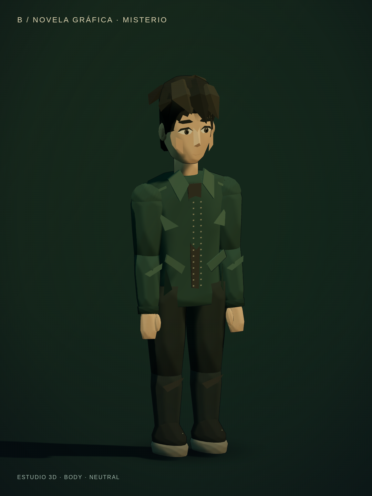
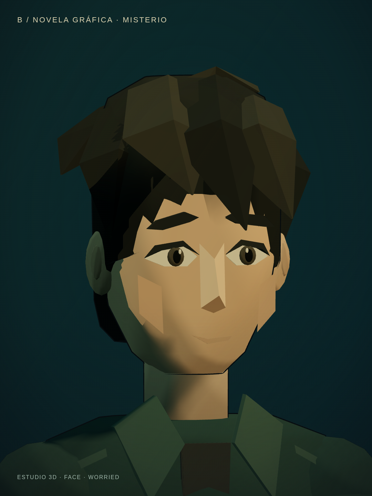
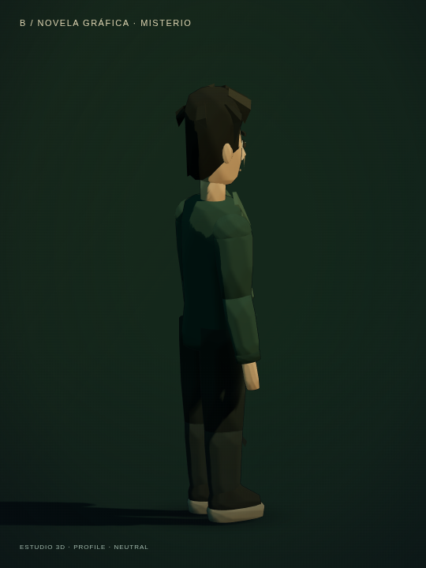
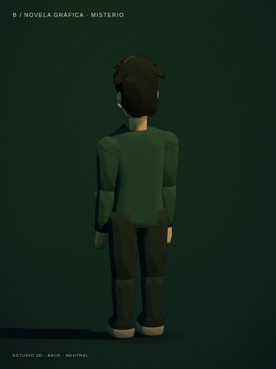
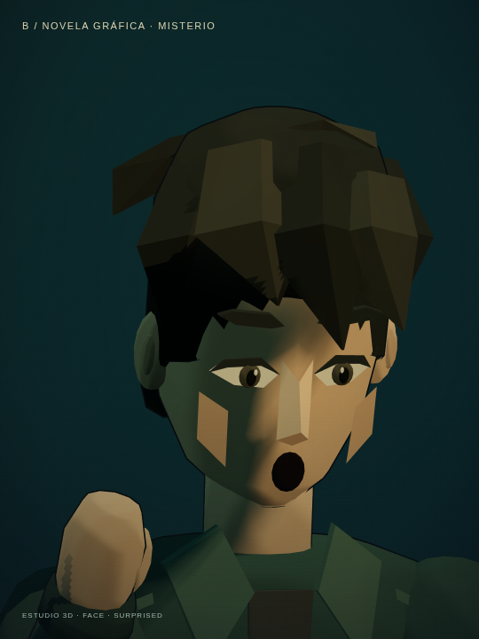

# Protagonista B · Novela gráfica / Misterio

Primera propuesta 3D exportada desde Blender y renderizada realmente en Remotion + React Three Fiber. La lámina conceptual orienta la dirección, pero este asset sigue siendo más geométrico y sencillo que la ilustración generada. No se presenta como una reproducción equivalente ni como una imagen 2D aplicada a un plano.

## Revisar en Studio

Carpeta **GraphicNovel**:

- **GraphicProtagonist**: cuerpo entero, 1080 × 1440, 30 fps.
- **GraphicPortrait**: estudio de rostro y expresión preocupada, mismo formato.

Las composiciones del hospital conservan su protagonista anterior mientras se revisa este diseño.

| Cuerpo entero | Rostro |
| --- | --- |
|  |  |

| Perfil | Espalda | Sorpresa |
| --- | --- | --- |
|  |  |  |

Estas imágenes son exportaciones de las composiciones, no conceptos generados con IA.

## Archivos del asset

- [GLB](../../public/models/graphic-protagonist.glb): geometría, materiales base y jerarquía de articulaciones.
- [Blender editable](../../public/models/graphic-protagonist.blend).
- [Fuente de construcción](../../scripts/build_graphic_protagonist.py): permite regenerar el asset con Blender 4.3.
- `src/components/characters/graphic/GraphicProtagonist.tsx`: carga y clonación del GLB, material cel, siluetas y poses por fotograma.
- `src/scenes/GraphicCharacterStudy.tsx`: cámara, iluminación y estudios.

El modelado es procedural en Blender: rostro con planos de mandíbula y mejillas, ojos almendrados, párpados, cejas articuladas, nariz, cabello en mechones, cuello, paneles de chaqueta, cremalleras, bolsillos, puños y calzado con suela. No usa texturas externas.

## Rig y materiales

La jerarquía de grupos articula hombros, codos, caderas, rodillas, torso y cabeza. Se reutiliza el motor de poses del proyecto. Es un rig de piezas rígidas, sin skinning, armature de deformación ni blend shapes: los extremos de movimiento pueden mostrar uniones o intersecciones y requieren revisión antes de sustituir al actor del hospital.

El GLB contiene materiales de color base. El componente de Three.js les aplica una rampa cel filtrada, variación superficial fija y contornos por extrusión de normales. Para obtener el mismo aspecto en Blender habría que reproducir la configuración de sombreado e iluminación; los renders de esta página se hicieron en Remotion.

La espera de carga del GLB usa `delayRender` y dibuja explícitamente el fotograma después del montaje y la aplicación de la pose. Las animaciones dependen del fotograma, no del tiempo de carga ni del reloj real.

## Comandos

```sh
npm start -- --no-open
npm run still:graphic
npm run render:graphic
npm run test:graphic
```

Para regenerar el modelo (Blender es necesario solo para esta operación):

```sh
blender -b --python scripts/build_graphic_protagonist.py
```

Para exportar otra vista:

```sh
npx remotion still src/index.ts GraphicProtagonist out/profile.png --props=configs/graphic-profile.json --frame=30 --gl=angle
npx remotion still src/index.ts GraphicPortrait out/surprise.png --props=configs/graphic-surprise.json --frame=30 --gl=angle
```

Si el equipo no admite ANGLE, usa `--gl=swangle`. El GLB funciona con las dependencias existentes; no se añadieron paquetes.

## Validación

- TypeScript y bundle completados.
- Tres pruebas del archivo GLB: cabecera/escena, articulaciones requeridas y presupuesto de triángulos.
- Renders de cuerpo entero y rostro revisados; se corrigieron carga asíncrona, apoyo de pies, unión de hombros, tamaño del cuello y separación de mechones.
- Perfil, espalda y sorpresa revisados; se corrigieron la nuca y las tapas de las mallas.
- Dos exportaciones finales del retrato producen el mismo SHA-256: `7ed4555e38667ba5ed1e1504d05fc739a0a36b67bdaca8325d26d06bd77e4983`.
