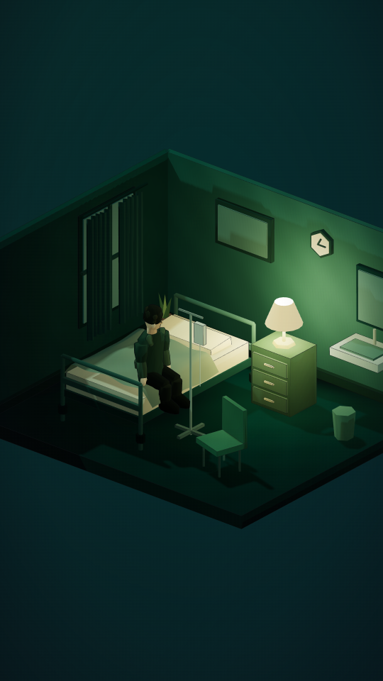
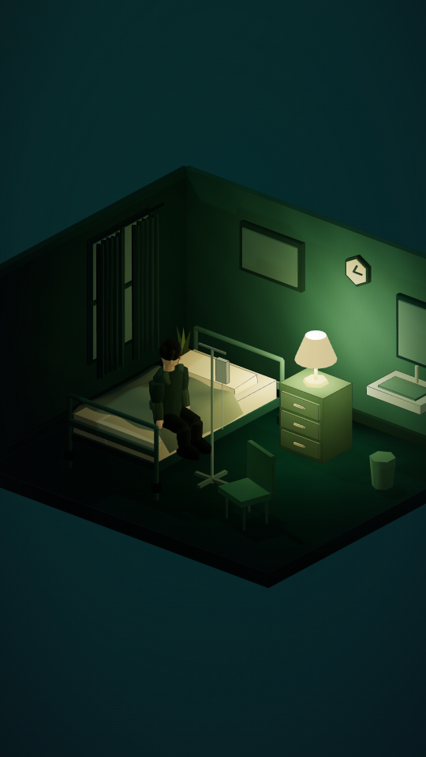
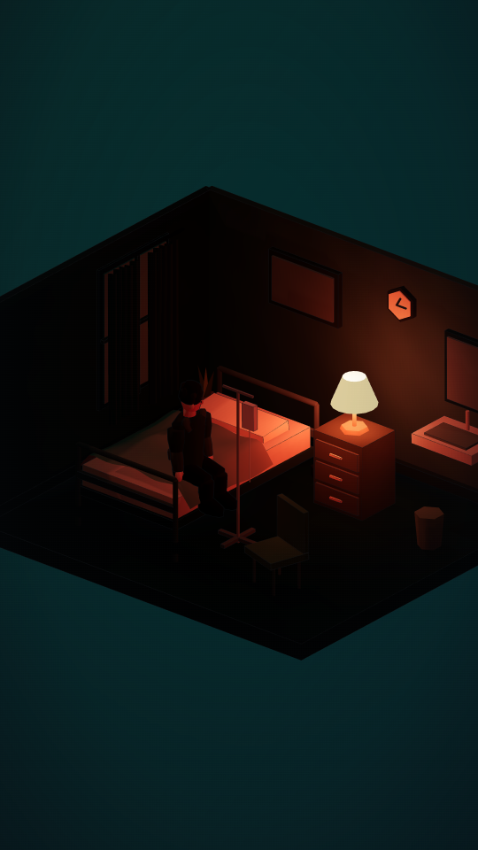
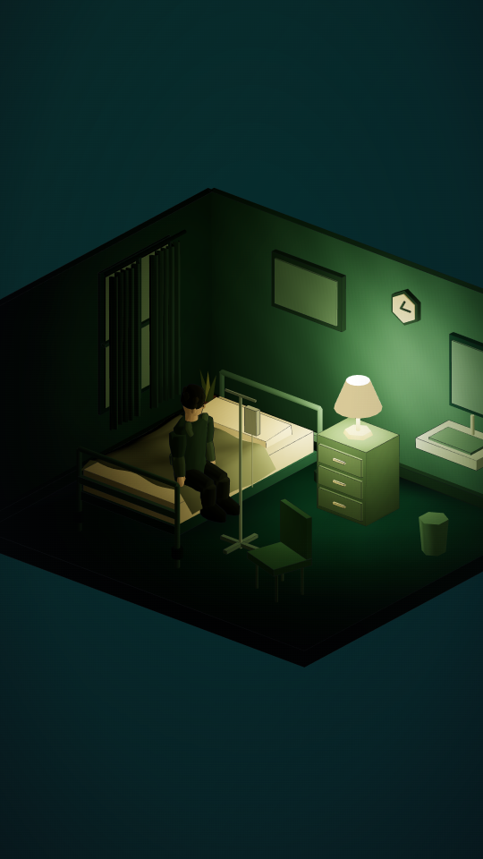
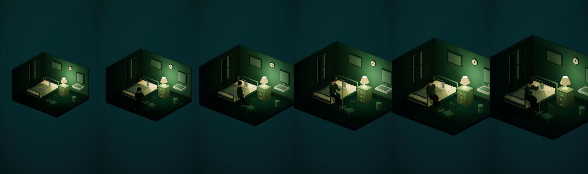

# Hospital narrativo para Shorts

Sistema de geometría 3D real sobre la sala de hospital existente, con paleta petróleo y beige, materiales mate, cámara ortográfica y luz cálida localizada. No usa imágenes de escenario sobre planos ni modelos externos. Los planos con gradientes de contacto solo aproximan sombras ambientales.

## Composiciones nuevas

En Studio, abre **Shorts**:

- **HospitalStory**: 1080 × 1920, 30 fps, 450 fotogramas (15 segundos).
- **ProtagonistActions**: presentación de las ocho acciones, 3 segundos por acción, 24 segundos en total.

Las composiciones anteriores Hospital, Workshop y Orbit conservan sus identificadores y configuraciones. No se añadieron dependencias.

| Tiempo | Acción |
| --- | --- |
| 0–3 s | Plano general isométrico de la habitación. |
| 3–6 s | El protagonista entra desde el borde abierto y se acerca a la cama. |
| 6–9 s | Gira, flexiona caderas y rodillas y queda sentado sobre el borde del colchón. |
| 9–12 s | Gira la cabeza hacia el reloj, con expresión preocupada. |
| 12–15 s | La lámpara tiene interrupciones pautadas y el personaje levanta los brazos, sorprendido. |

La cámara se acerca de forma continua mediante una interpolación suave. Se mantiene una composición de diorama vertical; el plano general deja espacio oscuro alrededor de la habitación.

## Arquitectura

```text
src/components/
  characters/
    CharacterRig.tsx         # Jerarquía de articulaciones, rostro y ropa
    CharacterAnimations.ts  # Poses puras y mezcla determinista
    Protagonist.tsx          # API de personaje para Remotion
  environments/Bedroom.tsx  # Ensamblaje modular del hospital
  props/
    Bed.tsx, Blanket.tsx, Nightstand.tsx, Lamp.tsx
    Window.tsx, Clock.tsx, Chair.tsx, IVStand.tsx
    Sink.tsx, Decorations.tsx
  lighting/CinematicLighting.tsx
  cameras/IsometricCamera.tsx
src/scenes/BedroomStory.tsx
src/scenes/CharacterShowcase.tsx
src/compositions/StoryShort.tsx
```

Reutiliza los materiales pintados de `scenes/Painted.tsx`, las siluetas de `scenes/Characters.tsx` y las sombras de contacto de `scenes/Atmosphere.tsx`. Los nuevos componentes se apoyan en la geometría del hospital original. Los objetos admiten agrupación de Three.js; los componentes Bed, Nightstand, Clock, Chair, IVStand, Sink y Decorations también aceptan un desplazamiento `position` y una rotación Y `rotation` sobre su posición de diseño.

## Personaje

```tsx
<Protagonist
  position={[0, 0, 0]}
  rotation={-Math.PI / 2}
  animation="think"
  expression="worried"
  lookAt={[1, 1, 0]}
/>
```

Acciones: `idle`, `walk`, `sit`, `talk`, `think`, `surprise`, `fear`, `lookAround`.

- `actionStart`: fotograma de inicio en la línea de tiempo del componente. Dentro de una Sequence de Remotion, los fotogramas son locales a esa Sequence.
- `blendFrom` y `blendFrames`: transición desde otra acción.
- `seated`: mantiene la parte inferior en pose sentada mientras se reproduce una acción superior.
- `lookAt` y `lookWeight`: objetivo de mirada en coordenadas de la escena y peso de interpolación. Limita el giro de cuello para evitar torsiones extremas.
- `poseOverride`: control fino de articulaciones para una escena concreta.

El personaje tiene hombros, codos, caderas y rodillas con pivotes jerárquicos. La respiración, la marcha, las expresiones y la boca se calculan por fotograma. Es un rig procedural, sin animación de piel ni captura de movimiento; caminar desplaza las piernas, y la trayectoria del personaje la controla la escena. La sentada debe ajustarse a la altura del asiento. La altura de este hospital deja los pies ligeramente colgando del colchón.

## Iluminación

Modos disponibles: `normal`, `night`, `red`, `single`. El modo `single` deja únicamente la lámpara como luz de escena. El parpadeo usa interrupciones y rampas en fotogramas fijos, sin aleatoriedad.

```tsx
<StoryShort lighting="red" />
```

Puedes editar las props JSON de HospitalStory en Studio, o pasar uno de los archivos de `configs/` al render:

```sh
npm run render:hospital-story -- --props=configs/hospital-red.json
npm run render:hospital-story -- --props=configs/hospital-single.json
```

## Uso

```sh
npm ci
npm start -- --no-open
npm run render:hospital-story
npm run still:hospital-story
npm run render:protagonist
```

Si ANGLE no está disponible, añade `-- --gl=swangle` al comando de render. El vídeo completo de HospitalStory se exporta a 1080 × 1920; las muestras del repositorio se exportan a menor resolución para facilitar su descarga.

## Verificaciones

```sh
npm run typecheck
npm run build
npm run test:animations
```

Las pruebas de acciones necesitan Node.js 22.6 o superior por el soporte de TypeScript sin compilación; se recomienda Node.js 22.18 o superior. Comprueban poses finitas y repetibles, alternancia de piernas, sentada y extremos de las transiciones. No garantizan ausencia de todas las intersecciones geométricas, que se revisan visualmente en los renders.

## Vistas de iluminación

| Normal | Noche | Roja | Una fuente |
| --- | --- | --- | --- |
|  |  |  |  |

[Vista del protagonista](protagonist.png)

## Validación realizada

- TypeScript y bundle completados.
- Seis pruebas de poses y mezcla aprobadas.
- Fotogramas nocturno, normal, rojo y de una sola fuente exportados e inspeccionados.
- Plano general, pose sentada y pose del protagonista inspeccionados.
- Dos renders del fotograma 300 a 540 × 960 produjeron el mismo SHA-256: `1d516c57c5a83c9414f66565cd6d8c66f283831635f01b2d33eae4de8eb67c73`.

Estas pruebas verifican el determinismo en el entorno de exportación usado; distintos controladores WebGL pueden introducir pequeñas diferencias de píxel.

## Demostración exportada

[Descargar MP4 de muestra (15 s, 450 fotogramas, 270 × 480)](hospital-story.mp4)

La composición de producción conserva 1080 × 1920 a 30 fps. La muestra usa escala 0,25 para facilitar su revisión y descarga.



De izquierda a derecha: fotogramas 60, 135, 195, 250, 310 y 380. Se inspeccionaron después de exportar el vídeo completo.
